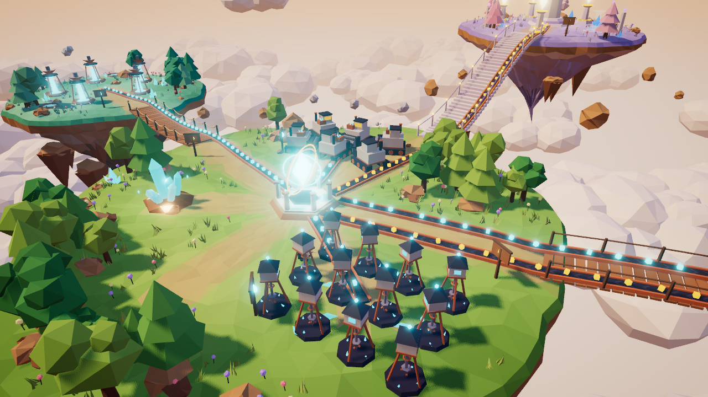
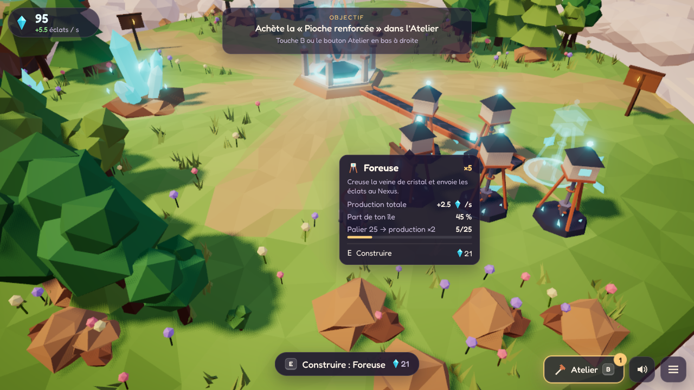
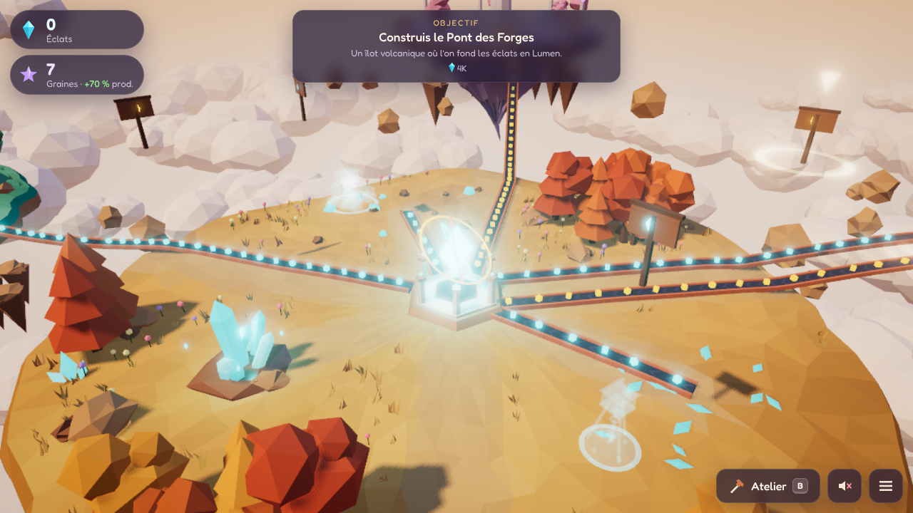
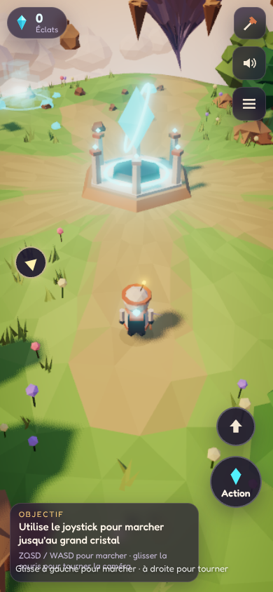

# Les Îles d’Éther

Un jeu incrémental (idle / clicker) **en 3D** dans le navigateur. Tu incarnes un petit explorateur sur une île flottante au coucher du soleil : tu récoltes un cristal d’éther à la pioche, tu construis des machines **posées physiquement sur l’île**, tu regardes les éclats rouler sur les tapis jusqu’au Nexus, tu relies de nouveaux îlots par des ponts… puis tu fais **descendre l’île** dans la mer de nuages pour en faire pousser une nouvelle, plus fertile.

**▶ Jouer :** https://francoisq890-dotcom.github.io/Island-idle/
*(le lien fonctionne une fois GitHub Pages activé, voir « Déploiement » plus bas)*

| | |
|---|---|
|  |  |
|  |  |

## Lancer en local

```bash
npm install
npm run dev        # http://localhost:5173
```

Autres commandes :

| Commande | Rôle |
|---|---|
| `npm test` | tests unitaires (économie, sauvegarde, hors-ligne, équilibrage) |
| `npm run simulate` | rapport d’équilibrage : un bot joue la première île (`-- --verbose` pour le détail) |
| `npm run build` | build de production dans `dist/` (≈ 190 Ko gzip) |
| `npm run preview` | sert le build de production |

## Commandes

| Action | Clavier / souris | Tactile |
|---|---|---|
| Marcher | **ZQSD** (AZERTY) ou **WASD** (QWERTY) ou flèches | joystick : glisser sur la moitié gauche de l’écran |
| Tourner la caméra | glisser avec la souris | glisser sur la moitié droite |
| Zoom | molette | pincer |
| Récolter | clic sur le cristal, ou **E** à côté (maintenir E = 3 coups/s) | toucher le cristal, ou bouton **Action** (maintenir) |
| Construire / interagir | **E** près d’un chantier, d’un pont, du Phare (ou clic dessus) | bouton **Action** |
| Sauter | **Espace** | bouton flèche |
| Atelier (machines, améliorations) | **B** | bouton marteau |
| Phare (prestige) | **P** | bouton Phare |
| Son on/off | **M** | bouton haut-parleur |
| Menu (réglages, sauvegarde, stats) | **Échap** | bouton menu |

## Ce qui est fait

- **Monde 3D** entièrement généré en code : 4 îles flottantes low-poly (Île Mère, Îlot des Forges volcanique, Îlot des Geysers turquoise, Île Céleste lavande), mer de nuages animée, rochers flottants, arbres / herbes / fleurs instanciés, lumière chaude, ombres, brouillard, bloom sur les cristaux, étalonnage + vignettage.
- **Personnage** animé (marche, respiration, saut, coup de pioche), caméra 3e personne amortie, collisions, les arbres entre la caméra et le joueur s’effacent.
- **Récolte manuelle** avec retour fort : particules, éclat lumineux du cristal, nombre qui s’envole, son cristallin dont la note monte en combo, léger screen shake.
- **5 machines** placées physiquement (foreuse, excavatrice, raffinerie, geyser d’éther, prisme solaire), animées, avec hologramme du prochain emplacement, apparition animée, paliers visibles (×2 à 25/50/100…, les machines grandissent et changent de teinte).
- **Convoyeurs** automatiques : les cubes cyan (éclats) et dorés (Lumen) circulent jusqu’au Nexus, la densité suit la production ; le Nexus tourne plus vite et pulse à chaque arrivée.
- **3 ponts** à construire (cinématique : les planches jaillissent une à une), nouvelles zones atteintes à pied.
- **20 améliorations**, coûts exponentiels `base × 1.15^n`, tout dans `src/config/economy.ts`.
- **Prestige** « faire descendre l’île » au Phare des étoiles : explication claire (gains / pertes), séquence cinématique, la nouvelle île repousse avec une nouvelle saison, bonus permanent +10 % par Graine d’étoile.
- **Hors-ligne** : production exacte pendant l’absence (max 8 h) + écran « Bon retour ! ».
- **HUD minimal** : ressources + taux/s, nombres formatés (1.2K, 3.4M… puis notation scientifique), info-bulles au survol et à l’approche (production, part du total, prochain palier, temps restant avant de pouvoir acheter).
- **Tutoriel diégétique** : 17 objectifs courts avec barre de progression, balise lumineuse dans le monde et flèche au bord de l’écran, puis objectifs dynamiques.
- **Audio 100 % synthétisé** (Web Audio) : effets + musique d’ambiance générative + vent.
- **Sauvegarde** automatique (10 s + fermeture), versionnée avec migrations, export/import en texte (`ILES1.…`).
- **Mobile** : joystick tactile, boutons Action/Saut, pincer pour zoomer, mise en page adaptée.
- **Performance** : instancing partout, ~130 draw calls toutes passes comprises sur une partie avancée, résolution adaptative, mode « Économie ».
- **Tests** Vitest (24 tests) + **simulation d’équilibrage** exécutés aussi en CI avant chaque déploiement.

## Équilibrage (résultat de `npm run simulate`)

| Profil du bot | Pont des Forges | Pont des Geysers | Île Céleste | Prestige dispo |
|---|---|---|---|---|
| Actif (3 clics/s) | ~2 min 50 | ~8 min 25 | ~20 min | **~32 min** |
| Moyen (2 clics/s, 10 min) | ~3 min 10 | ~8 min 55 | ~25 min | **~41 min** |
| Paresseux (1 clic/s, 3 min) | ~3 min 45 | ~9 min 30 | ~27 min | **~43 min** |

Plus longue attente entre deux achats pendant les 10 premières minutes : ~1 min 30 (cible : < 3 min). Le bot est quasi optimal ; un humain qui explore sera un peu plus lent.

## Déploiement (GitHub Pages)

Le workflow `.github/workflows/deploy.yml` teste, simule, construit et publie `dist/` sur GitHub Pages à chaque push sur `main` (et sur la branche de développement).
Une seule action manuelle est nécessaire la première fois : **Settings → Pages → Source : « GitHub Actions »**. Si l’environnement `github-pages` refuse la branche de développement, fusionne-la dans `main` (ou autorise la branche dans *Settings → Environments → github-pages*).

## Vérification visuelle

Le jeu a été vérifié avec Chromium headless (Playwright, WebGL logiciel) : écran titre, tutoriel, récolte, construction, toutes les îles, panneaux, écran hors-ligne, séquence de prestige et affichage mobile ont été capturés et inspectés pendant le développement.

## Limites connues / reste à faire

- Le rendu logiciel headless est lent, donc les 60 fps n’ont pas pu être mesurés sur une vraie carte graphique ici ; la résolution adaptative compense automatiquement si un appareil peine.
- Contenu : une seule couche de prestige et 5 machines (~40 min pour la première île, plus rapide ensuite). Pistes : arbre de talents payé en graines, événements aléatoires (pluie de cristaux), succès, plus de saisons.
- Pas de remappage des touches (les touches physiques sont utilisées, donc ZQSD et WASD marchent tous les deux).
- Au-delà du nombre d’emplacements d’un chantier (5 à 12), les nouvelles machines ne sont plus ajoutées visuellement : ce sont les machines existantes qui grandissent et changent de teinte à chaque palier.
- Textes en français uniquement.

## Structure

```
src/config/    économie (fichier unique), palette, disposition du monde
src/economy/   règles pures, hors-ligne, objectifs, bot de simulation
src/save/      sauvegarde versionnée
src/world/     rendu 3D : terrain, décor, machines, convoyeurs, ponts, joueur, caméra, particules
src/ui/        HUD, panneaux, icônes, CSS
src/audio/     synthèse sonore
src/game.ts    orchestration
tests/         Vitest
scripts/       simulation d’équilibrage, captures d’écran Playwright
```

Voir **DECISIONS.md** pour les choix de design et de technique.
