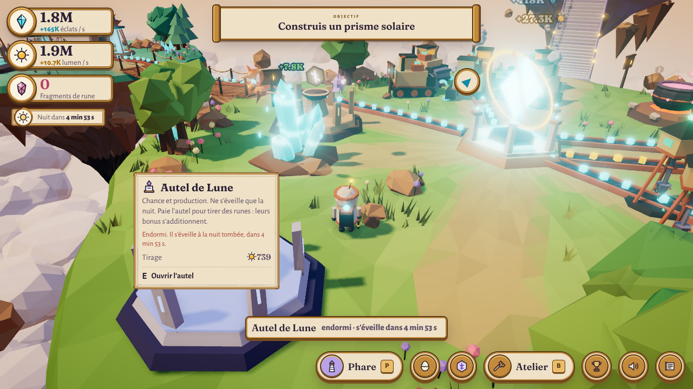
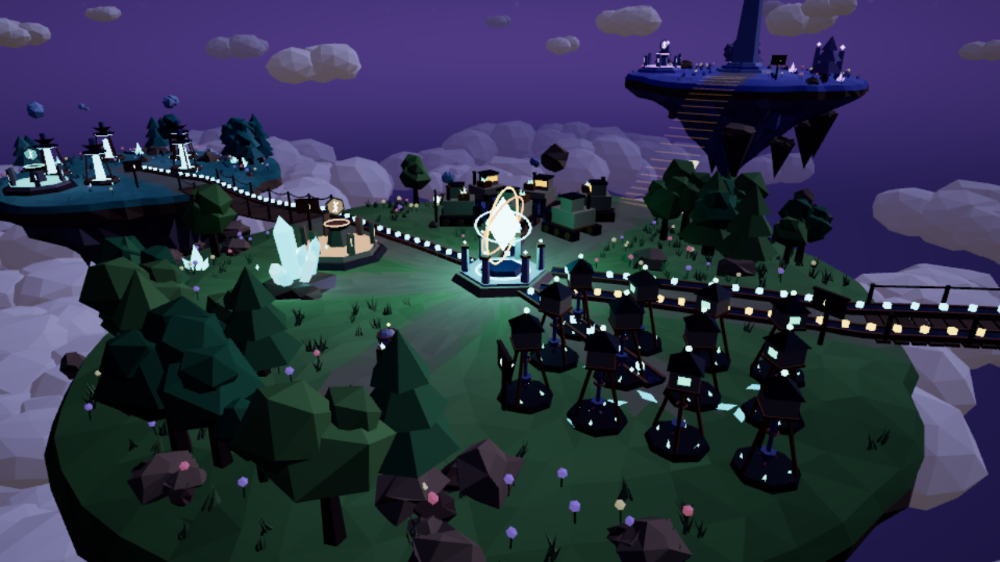
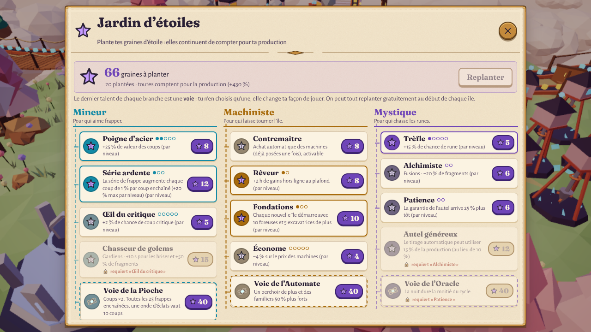
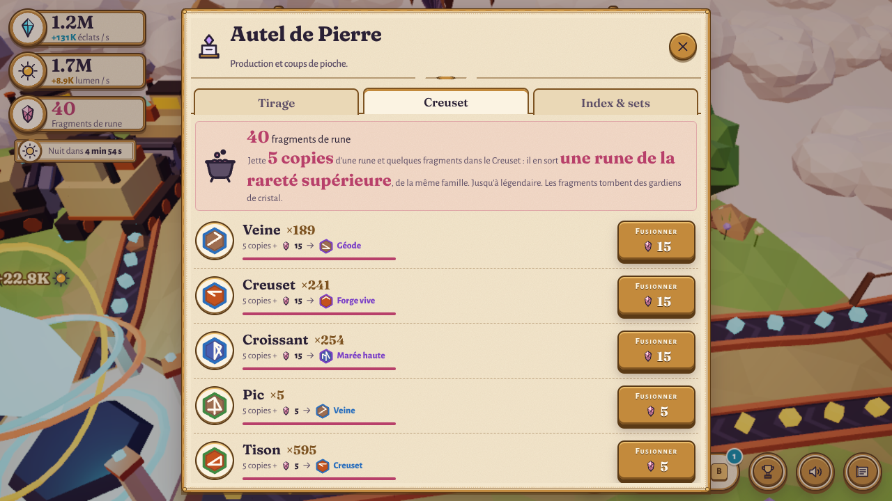
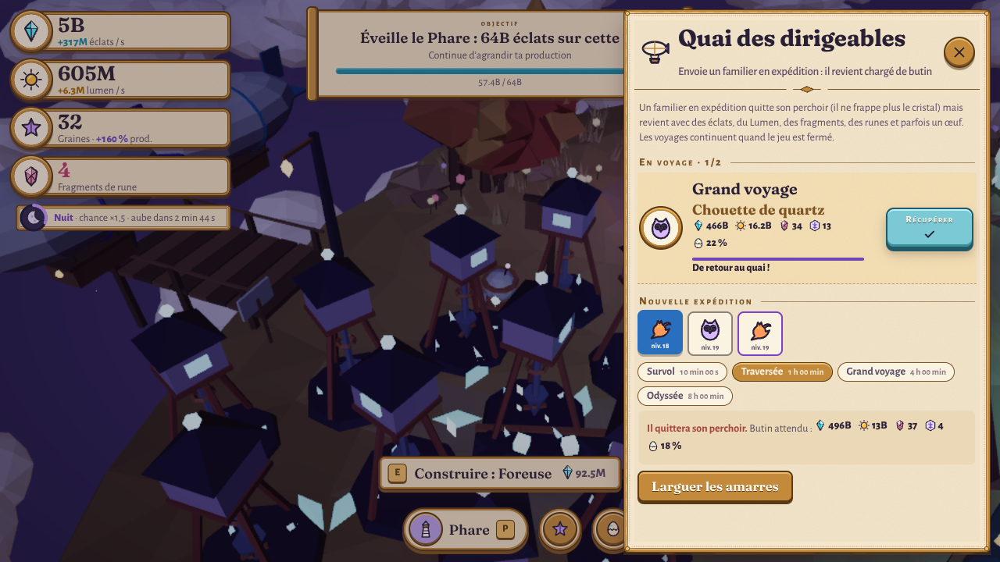
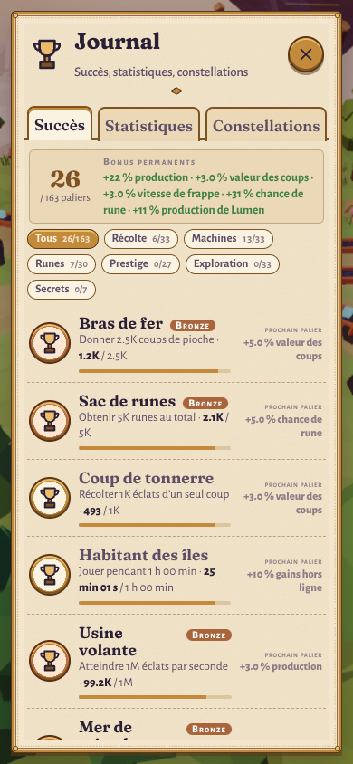
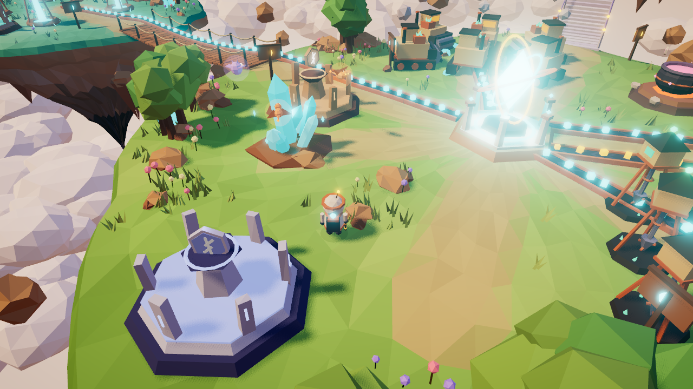

# Les Îles d’Éther

Un jeu incrémental (idle / clicker) **en 3D** dans le navigateur. Tu incarnes un petit explorateur sur une île flottante au coucher du soleil :
- tu récoltes un cristal d’éther à la pioche ;
- tu construis des machines **posées physiquement sur l’île** et tu regardes les éclats rouler sur les tapis jusqu’au Nexus ;
- tu relies de nouveaux îlots par des ponts, tu tires et fusionnes des runes, tu brises des gardiens de cristal et tu élèves des familiers ;
- puis tu fais **descendre l’île** dans la mer de nuages pour en faire pousser une nouvelle, avant d’élever un jour **tout l’archipel au-dessus des nuages**.

**▶ Jouer :** https://francoisq890-dotcom.github.io/Island-idle/

| | |
|---|---|
|  |  |
|  |  |
|  |  |

## Lancer en local

```bash
npm install
npm run dev        # http://localhost:5173
```

| Commande | Rôle |
|---|---|
| `npm test` | 98 tests (≈ 1 min), dont l’équilibrage de 5 profils de joueur sur un cycle complet |
| `npm run simulate` | rapport d’équilibrage : le bot joue jusqu’à l’Ascension (`-- --verbose` pour le détail par île) |
| `npm run test:e2e` | déplacement clavier (AZERTY/QWERTY) et joystick, dans un vrai navigateur |
| `npm run build` | build de production dans `dist/` |

## Commandes

| Action | Clavier / souris | Tactile |
|---|---|---|
| Marcher | **ZQSD** (AZERTY) ou **WASD** (QWERTY) ou flèches | joystick (moitié gauche de l’écran) |
| Caméra | glisser la souris · molette | glisser à droite · pincer |
| Frapper (cristal, gardien, faille) | clic dessus, ou **E** à côté (maintenir = coups enchaînés) | toucher, ou bouton **Action** |
| Interagir (chantier, pont, autel, nid, quai, Creuset, marchand, Phare) | **E** ou clic | bouton **Action** |
| Sauter (et éviter l’onde de choc des gardiens) | **Espace** | bouton flèche |
| Atelier | **B** | marteau |
| Runes | **R** | rune |
| Nid d’éther (familiers) | **N** | œuf |
| Jardin d’étoiles (talents) | **T** | étoile |
| Journal (succès, statistiques, constellations) | **J** | trophée |
| Phare (prestige, Ascension) | **P** | Phare / couronne |
| Son · Carnet de bord (réglages, sauvegarde) | **M** · **Échap** | haut-parleur · carnet |

## Nouveautés de l’itération 3

Le plan complet est dans **DESIGN.md**, l’équilibrage dans **BALANCE.md**.

- **62 succès à paliers** (bronze, argent, or) en 6 catégories, dont 10 cachés. Chaque palier donne un bonus permanent. Une page dédiée avec filtres et la progression de chaque succès, et un **écran de statistiques** complet.
- **Cycle jour/nuit** : toutes les 8 minutes, 2 minutes de nuit, avec étoiles, lune et aurores, des cristaux qui brillent, des grillons, et une chance de rune ×1,5.
- **Runes étendues** :
  - deux nouvelles familles : la **Lune**, dont l’autel ne s’éveille que la nuit, et le **Gardien**, butin des golems ;
  - la **fusion** au Creuset runique : 5 doublons et des fragments donnent la rareté supérieure ;
  - **8 sets** ;
  - une **pitié** légère : épique garantie après 100 tirages, légendaire après 1 000 ;
  - des **mythiques à effet unique** : un écho de chaque coup, des critiques en chaîne, une nuit deux fois plus longue.
- **Gardiens de cristal** : un golem surgit, il faut le briser à la pioche en 35 s et **sauter** son onde de choc. Il lâche des fragments, des runes et parfois un œuf.
- **Familiers d’éther** : quatre espèces et quatre raretés. Ils volent autour du cristal et le **frappent pour toi**. On les fait éclore au Nid d’éther et on les fait monter de niveau.
- **Jardin d’étoiles** : trois branches de talents payées en graines (qui continuent de compter pour la production), avec un **achat automatique** des machines et des **voies exclusives** : Pioche, Automate ou Oracle.
- **Expéditions** : un dirigeable emmène un familier de 10 min à 8 h, et il revient chargé de butin, même quand le jeu est fermé.
- **Événements** : la **faille d’éther** (production ×3 pendant 45 s) et le **marchand ambulant**.
- **Ascension** : seconde couche de prestige, avec des couronnes, **6 reliques** qui changent les règles et **5 défis** qui rapportent des bonus permanents.
- **Équilibrage global** : 5 profils de joueur (optimal, moyen, idle, chanceux, « ne lit rien ») sont testés automatiquement sur un cycle complet. Les emballements trouvés ont été corrigés (BALANCE.md).
- **Rendu et sensations** :
  - préréglages Économie / Moyenne / Haute / Ultra / Automatique ;
  - rayons de soleil et de lune, occlusion ambiante (Ultra), vent dans les arbres et l’herbe, cristal scintillant, mer de nuages qui respire ;
  - écrasement et étirement aux sauts, petite célébration, compteurs qui défilent, gains qui volent jusqu’au HUD, compteur de série, zoom brusque sur les grands moments, vibrations sur mobile ;
  - musique qui s’enrichit avec la production, sons jamais identiques.
- Les sauvegardes précédentes sont **migrées automatiquement** (formats v3 et v4).

| Avant le polish | Après (Ultra) |
|---|---|
|  |  |

## Équilibrage mesuré (`npm run simulate`)

| Profil | 1er prestige | 2e île | Ascension |
|---|---|---|---|
| Actif optimal (3 coups/s sans pause) | 27 min | 10 min | 2,4 h |
| Moyen (2 coups/s, 10 min par île) | 37 min | 18 min | 5,5 h |
| Surtout idle | 42 min | 22 min | 4,7 h |
| Chanceux (tirages favorables forcés) | 26 min | 5 min | 3,7 h |
| Ne lit rien (achats au hasard) | 1 h 10 min | 26 min | 5,6 h |

Le jeu ne laisse jamais plus d’environ 15 s sans rien à acheter (hors profil « au hasard »). Les détails, les corrections et les plafonds sont dans BALANCE.md.

## Limites connues

- Les 60 fps n’ont pas pu être mesurés sur une vraie carte graphique ici (rendu logiciel en headless). Le mode « Automatique » baisse la résolution puis le préréglage si les images ralentissent.
- Le bug « seule Z fonctionne » n’a pas pu être reproduit à l’identique dans Chromium. Trois vraies causes ont été corrigées (voir DECISIONS.md). Si le problème persiste chez toi, le nom et la version de ton navigateur m’aideraient.
- Au-delà des emplacements d’un chantier, les nouvelles machines ne s’ajoutent plus visuellement : celles qui existent grandissent aux paliers.
- Pas de remappage des touches ; textes en français uniquement.

## Structure

```
src/config/    données : économie, runes, succès, jour/nuit, gardiens, familiers, talents, expéditions, Ascension, monde, palette
src/economy/   règles pures + bot de simulation + campagne + cibles d’équilibrage
src/save/      sauvegarde versionnée + migrations (v1 → v4)
src/world/     rendu 3D
src/ui/        HUD et panneaux (Carnet du Cartographe)
src/audio/     synthèse sonore et musique adaptative
tests/         Vitest
scripts/       simulation, sauvegardes de test, e2e, captures
```

Voir **DESIGN.md** (progression et systèmes), **BALANCE.md** (équilibrage) et **DECISIONS.md** (choix et raisons).
